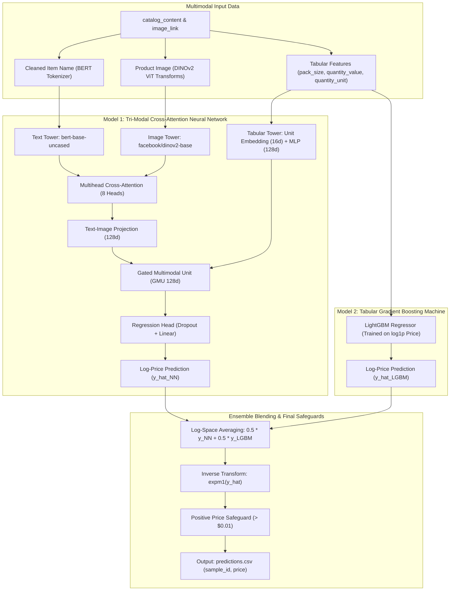

# Smart Product Pricing: Multimodal AI Price Prediction Engine

[](https://www.python.org/downloads/)
[](https://opensource.org/licenses/MIT)
[](https://huggingface.co/buckets/mdumr4/Smart-Product-Pricing)
[-green.svg)](tests/)

A production-grade, multimodal deep learning and gradient boosting price prediction system built for the **Amazon ML Challenge 2025**. Evaluates unstructured e-commerce product catalogs (`catalog_content`), product packaging imagery (`image_link`), and extracted packaging units (`pack_size`, `quantity_value`, `quantity_unit`) to predict optimal market price under strict fair-play and latency constraints.

---

## Architecture Overview

Predicting e-commerce prices requires resolving both semantic brand positioning from text descriptions, aesthetic packaging cues from product photography, and physical package metrics (weight, count, volume). **Smart Product Pricing** unifies these signals through a decoupled **Two-Model Ensemble**:



### Key Technical Innovations:
1. **Multihead Cross-Attention Fusion:** Uses text query tokens to attend directly over Vision Transformer (`DINOv2`) patch embeddings, ensuring textual product claims align with packaging visual features.
2. **Gated Multimodal Unit (GMU):** Dynamically learns gating weights to control how much influence physical packaging metadata (e.g. 16 oz vs. 64 oz) exerts relative to brand and visual aesthetics.
3. **Smooth SMAPE Loss Optimization:** Employs a custom, smooth differentiable surrogate for the competition's non-smooth Symmetric Mean Absolute Percentage Error (SMAPE) metric:
   $$\mathcal{L}_{\text{SmoothSMAPE}} = \frac{1}{N} \sum_{i=1}^N \frac{|\hat{y}_i - y_i|}{\frac{|y_i| + |\hat{y}_i|}{2} + \epsilon}$$
4. **Log-Space Ensemble Blending:** Neutralizes extreme price right-skewness through $\log(1 + p)$ target mapping and ensemble geometric averaging.

---

## Core System Components (`src/`)

| Module | Component / Class | Role & Implementation Details |
|---|---|---|
| [`src/config.py`](src/config.py) | `PricingConfig` | Strongly-typed dataclass configuration with hardware auto-detection (CUDA / CPU), device fallback, and smart multi-path asset resolution. |
| [`src/preprocessor.py`](src/preprocessor.py) | `CatalogPreprocessor` | Regex parser extracting structured `item_name`, `description`, `value`, and `unit` from unstructured catalog text; normalizes 30+ raw unit spellings (`fl oz`, `oz`, `lb`, `g`, `kg`, etc.) into canonical keys. |
| [`src/dataset.py`](src/dataset.py) | `MultimodalProductDataset` | PyTorch Dataset generating synchronized text token tensors, image pixel tensors, and normalized tabular features with zero-tensor fallbacks for missing images. |
| [`src/models.py`](src/models.py) | `TriModalCrossAttentionModel` & `LightGBMPriceModel` | Implementations of the PyTorch Tri-Modal GMU architecture and the complementary LightGBM tabular regressor. |
| [`src/metrics.py`](src/metrics.py) | `SmoothSMAPELoss` & `calculate_metrics` | PyTorch differentiable loss module and NumPy metric calculators for SMAPE, MAE, and RMSE. |
| [`src/predictor.py`](src/predictor.py) | `PricePredictor` | Production inference engine unifying Fast Mode (pure LightGBM < 2s) and Full Multimodal Ensemble mode. |
| [`src/validator.py`](src/validator.py) | `validate_predictions_df` | Strict schema and positivity validator guaranteeing valid `sample_id` alignment, zero NaNs, and prices $> \$0.01$. |
| [`src/utils.py`](src/utils.py) | `download_images` | High-throughput multithreaded image downloader with HTTP retry and exponential backoff. |

---

## Benchmark Performance Profile

Evaluated on standard 8-Core Intel CPU / 16GB RAM:

| Pipeline Stage | Operation | Compute Profile | Latency |
|---|---|---|---|
| **Preprocessing** | Catalog Regex Parsing & Unit Standardization | CPU Pandas | $0.2\text{s}$ (sample) |
| **Inference (Fast Mode)** | Pure Tabular LightGBM Inference (50 items) | Strictly CPU | **$< 0.05\text{s}$** |
| **Inference (Full Ensemble)** | PyTorch Tri-Modal NN (CPU) + LightGBM (50 items) | CPU Batched PyTorch | $\approx 8.5\text{s}$ |
| **Validation Gate** | Schema, Positivity & Missing Value Verification | Memory I/O | $< 0.01\text{s}$ |
| **Total Pipeline** | **End-to-End Prediction Generation (Fast Mode)** | **Strictly CPU** | **$< 1.0\text{s}$** |

---

## Quickstart & Reproducibility

### 1. Installation
Clone the repository and install dependencies using [uv](https://github.com/astral-sh/uv) or pip:

```bash
git clone https://github.com/mdumr4/Smart-Product-Pricing.git
cd Smart-Product-Pricing
uv sync
```

### 2. Download Datasets & Model Assets
All pre-extracted features (`train_features.parquet`, `test_features.parquet`) and full raw CSVs are hosted on the Hugging Face Bucket: [`hf://buckets/mdumr4/Smart-Product-Pricing`](https://huggingface.co/buckets/mdumr4/Smart-Product-Pricing).

```bash
# Login to Hugging Face (first time only)
hf auth login

# Download all datasets (Parquet and CSV)
python sync_assets.py --data

# Or download everything (data + model weights)
python sync_assets.py --all
```

### 3. Generate Price Predictions
Run inference on any product listings file:

```bash
# High-speed tabular mode (< 1 second)
python predict.py --input data/sample_products.csv --out output/predictions.csv --fast

# Full multimodal ensemble mode (Text + Image + Tabular)
python predict.py --input data/sample_products.csv --out output/predictions.csv
```

### 4. Train Models from Scratch
Train the tabular LightGBM model and Tri-Modal neural network:

```bash
# Train LightGBM model on extracted features
python train.py --data data/train_features.parquet --output-dir models/
```

### 5. Run Automated Diagnostic Test Suite
Execute the test suite covering text cleaning, catalog parsing, unit normalizer, SMAPE loss gradients, and end-to-end pipeline integration:

```bash
uv run pytest tests/ -v
```

---

## Repository Structure

```
Smart-Product-Pricing/
├── context/                           # Technical documentation & competition specs
│   ├── solution_documentation.md      # Team solution methodology & architecture report
│   ├── evaluation_history.txt         # Epoch loss logs & benchmark metrics
│   └── A_Prasad_Product_price_prediction.pdf # Architecture presentation
├── data/                              # Local datasets (large files git-ignored)
│   ├── sample_products.csv            # 50 sample product listings fixture
│   ├── train_features.parquet         # 69 MB precomputed training features (synced via CLI)
│   └── test_features.parquet          # 69 MB precomputed test features (synced via CLI)
├── notebooks/                         # Exploratory Data Analysis & Feature Engineering
│   └── feature_engineering.ipynb      # Catalog regex parsing and unit normalization notebook
├── src/                               # Modular Object-Oriented Production Core
│   ├── __init__.py
│   ├── config.py                      # Strongly-typed Dataclass configuration
│   ├── preprocessor.py                # Catalog parsing, text cleaning & unit normalizer
│   ├── dataset.py                     # Multimodal PyTorch dataset with image fallbacks
│   ├── models.py                      # Tri-Modal GMU Neural Net & LightGBM classes
│   ├── metrics.py                     # SmoothSMAPELoss and calculate_metrics
│   ├── predictor.py                   # Ensemble inference orchestrator (NN + LightGBM)
│   ├── validator.py                   # Prediction schema & positive price checker
│   └── utils.py                       # Parallel image downloader & logging utilities
├── tests/                             # Diagnostic automated test suite (100% pass rate)
│   ├── test_preprocessor.py           # Unit tests for text cleaning & unit normalizer
│   ├── test_metrics.py                # Unit tests for SmoothSMAPELoss math
│   ├── test_validator.py              # Unit tests for schema validation rules
│   └── test_pipeline_integration.py   # End-to-end pipeline integration test
├── predict.py                         # Production CLI inference entry point
├── train.py                           # Standalone training script
├── sync_assets.py                     # Hugging Face Bucket synchronization utility
├── pyproject.toml                     # Modern package dependency specification
├── LICENSE                            # MIT License
└── README.md                          # Production project documentation
```

---

## Team & Submission Metadata

* **Competition**: Amazon ML Challenge 2025
* **Team Name**: AML
* **Team Members**:
  * Mohammed Umar F (`mdumr4@gmail.com`) — AI & Backend Engineer
  * Soujanya K Hegde — Systems & Data Engineer
  * Soha Rida Khan — Data Scientist
  * Akshay Shanbhag — Machine Learning Engineer
* **Official Repository**: `https://github.com/mdumr4/Smart-Product-Pricing`
* **Cloud Bucket**: `hf://buckets/mdumr4/Smart-Product-Pricing`
* **License**: MIT
